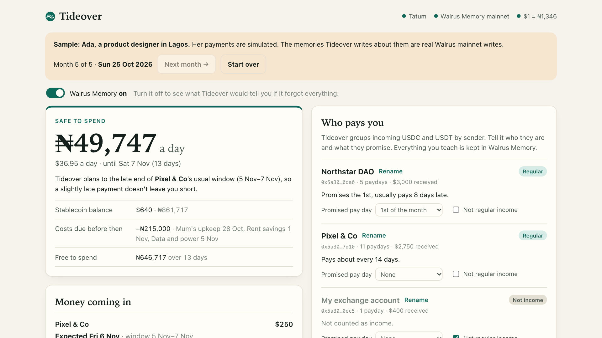
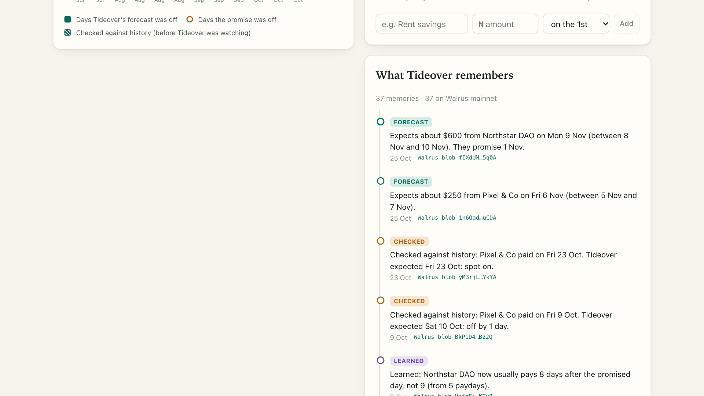
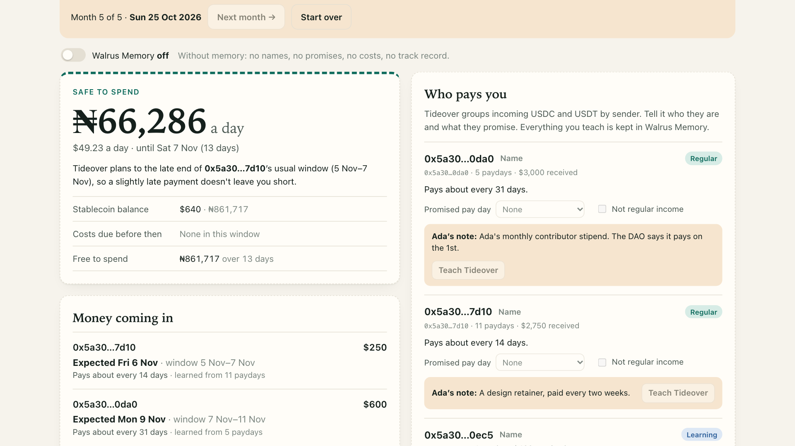

# Tideover

**Know what you can spend, even when pay comes late.**

Tideover is for people who are paid in stablecoins at irregular times: freelancers, DAO contributors, remote workers. It watches your Sui wallet through Tatum and learns when each payer *really* pays you. It then tells you how much you can safely spend each day until the next payment lands. Everything it learns is kept in Walrus Memory on Sui mainnet, so it gets sharper every month and follows you to any device.

Built for the Tatum × Walrus **Total Recall** hackathon, Consumer Finance track.

**Demo video:** https://youtu.be/f2WeF2j2nnY · **Write-up:** https://0xkenichi.github.io/blog/tideover/



## Why

A client says they pay on the 1st, and the money lands on the 9th. A DAO stipend arrives some time in the second week. Budgeting apps assume a salary that arrives on the same day every month, so they tell you the wrong thing exactly when money is tight.

Tideover doesn't trust the promise. It learns each payer's real habits and plans for the late end of their usual window.

## What it does

- **Reads your wallet.** It finds incoming USDC and USDT on Sui mainnet, groups the payments by who sent them, and merges split payments into one payday.
- **Learns from you.** You name your payers, tell it what day they promise to pay, mark one-off money (a bounty, a transfer from your own exchange account), and add your monthly costs in naira. Each of these is a memory.
- **Forecasts each regular payer.** You see "Promised 1 Nov. Expected Mon 9 Nov, between 8 and 10 Nov", learned from how late they've paid before. Without a promise, it learns the rhythm instead ("about every 14 days").
- **Tells you what's safe to spend.** It takes your stablecoin balance, subtracts the costs due before the late end of the next payment window, and divides by the days in between. Amounts are shown in naira at Tatum's live rate.
- **Grades itself.** Every forecast is remembered. When the money lands, Tideover checks it against the forecast it made earlier, stores the grade, and adjusts. A chart compares how far off its forecasts were with how far off simply trusting the promise would have been.
- **Shows its memory.** A timeline lists every memory with a link to its Walrus blob. A **Walrus Memory on/off** switch shows what Tideover would tell you if it forgot everything: raw addresses instead of names, no promises, no costs, no track record, and a very different spending number.

## The learning loop

```
            ┌──────────── Tatum (Sui mainnet) ────────────┐
            │ incoming USDC/USDT, balances, SuiNS names    │
            └──────────────────────┬───────────────────────┘
                                   ▼
 Walrus Memory ──recall──▶  learn(payments, memories, now)  ──▶ forecasts, safe-to-spend
      ▲                            │
      └────remember────── new memories: what you taught,
                          forecasts, grades, lessons
```

`learn()` in `src/lib/engine.ts` is one pure function. It walks every payday in time order. Before each payday it looks for the forecast Tideover held at the time: first in Walrus Memory (a real prediction made before the money arrived), otherwise by working it out from earlier history, marked as "checked against history". It grades that forecast, learns from the payday, records any lesson, and finally makes a fresh forecast for each regular payer. Any record that isn't already in memory is written to Walrus.

There are four kinds of memory, each stored as one Walrus Memory entry. The entry holds a plain English sentence, so semantic recall works and a person can read it, followed by a tagged JSON copy of the record:

| Memory | Example |
|---|---|
| You taught | You said Northstar DAO promises to pay on the 1st of each month. |
| Forecast | Expects about $600 from Northstar DAO on Thu 9 Jul (between 6 and 12 Jul). They promise 1 Jul. |
| Checked | Northstar DAO paid on Sat 11 Jul. Tideover expected Thu 9 Jul: off by 2 days. Going by the promise (1 Jul) would have been off by 10 days. |
| Learned | Learned: Northstar DAO now usually pays 9 days after the promised day, not 8 (from 2 paydays). |

The app has no database. Chain data is read fresh from Tatum each time, and everything Tideover has learned is recalled from Walrus Memory. Each wallet has its own namespace (`tideover:<address>`). Record IDs are deterministic, so the same fact is never written twice.

## How it uses Tatum

All chain reads go through Tatum, server-side, with the API key kept out of the browser (`src/server/tatum.ts`).

- **Sui mainnet through Tatum's gateway** (`https://sui-mainnet.gateway.tatum.io/graphql`). Sui has deprecated JSON-RPC on public full nodes, and Tatum's Sui gateway now serves GraphQL, so Tideover uses that. One query reads the wallet's balances, its SuiNS name and its recent transactions with balance changes. Tideover pages back through up to 200 transactions. A second query (`multiGetAddresses`) looks up the SuiNS names of the people who paid you. SuiNS names typed on the start screen are resolved through `nameRecord`.
- **Tatum Data API** for the dollar-to-naira rate (`/v4/data/rate/symbol?symbol=USDC&basePair=NGN`).

## How it uses Walrus Memory



`src/server/memory.ts` uses the official SDK, `@mysten-incubation/memwal`, with the mainnet relayer.

- `rememberBulkAndWait` writes new records in batches of up to 20 and returns each one's Walrus blob ID, which the timeline links to on Walruscan.
- `recall` with several broad queries (limit 100 each) loads everything Tideover remembers about a wallet when you open it.
- Memories are encrypted by the relayer before they are stored on Walrus.
- One run of the five-month sample writes 37 memories to Walrus mainnet: what you taught it, its forecasts, its grades and its lessons.

Turn the **Walrus Memory** switch off and Tideover acts as if it remembered nothing. In the sample it forgets Ada's ₦215,000 of monthly costs, and the safe-to-spend figure jumps from about ₦49,700 a day to ₦66,282:



## Try it

You need Node 22 or newer.

```bash
npm install
cp .env.example .env.local   # then fill in your keys
npm run dev
```

Open http://localhost:3000. Then:

- **Sample mode** ("watch Tideover learn five months of a Lagos designer's pay") replays simulated payments for a fictional designer, Ada, one month at a time. Teach it what Ada's notes say, click **Next month**, and watch the forecasts, the grades and the chart change. The payments are made up. The memories are real Walrus mainnet writes, in a fresh namespace for each run.
- **Your wallet:** paste a Sui address or a `name.sui`. Tideover reads it through Tatum, checks its forecasts against your history, and starts remembering.

### Keys

| Variable | Where to get it |
|---|---|
| `TATUM_API_KEY` | [dashboard.tatum.io](https://dashboard.tatum.io) → API keys (free plan works) |
| `MEMWAL_KEY` | [memory.walrus.xyz/dashboard](https://memory.walrus.xyz/dashboard) → your account → Delegate keys (the private key) |
| `MEMWAL_ACCOUNT_ID` | Same dashboard: your Walrus Memory account ID |

Without a Tatum key, the gateway still answers, but only 5 requests a minute, and there's no naira rate. Without Walrus Memory keys, the app still runs, but nothing is saved. It says so in the top bar. On a public deployment, set `TIDEOVER_READ_ONLY=true` so visitors can't write to your memory.

### Tests

```bash
npm test
```

The tests cover the learning loop (grading remembered forecasts, never writing a memory twice, the memory-off view, teachings where the latest wins), the spending plan, the memory format, and the parsing of Tatum's Sui responses.

## Project layout

```
src/lib/engine.ts        the learning loop (pure, tested)
src/lib/money.ts         safe-to-spend plan
src/lib/records.ts       memory format: sentence + tagged JSON
src/lib/sample.ts        Ada's simulated payments
src/server/tatum.ts      Tatum Sui GraphQL gateway + Data API
src/server/memory.ts     Walrus Memory (MemWal) client
src/app/api/*            wallet, rate, memory and status routes
src/components/*         the one-screen app
```

## Honest limits

- It counts USDC and USDT on Sui only. Money that arrives in SUI or another token isn't treated as income.
- Payers are identified by sending address. Withdrawals from an exchange all come from the exchange's address, so mark them "not regular income" or name them.
- It reads the last 200 transactions. A very busy wallet may have older paydays out of reach.
- It plans; it doesn't move money, connect to your wallet or hold keys. It isn't financial advice.

## License

MIT
